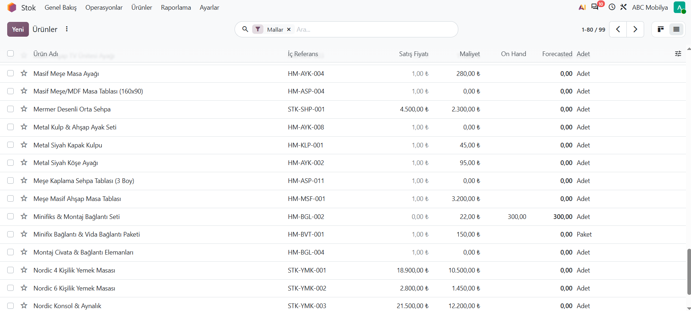

# REQ-001: Master Data Management (Ana Veri Yönetimi)

## 💡 İş Mantığı ve Odoo Entegrasyonu
ABC Mobilya dijital dönüşüm projesinde, tedarik zinciri, üretim ve satış süreçlerinin hatasız ve entegre bir şekilde yürütülebilmesi için ana verilerin standardizasyonu kritik bir adımdır. Bu kapsamda:
- **Ürün Kartları:** Hammaddeler, yarı mamuller ve bitmiş mamul mobilyalar belirli bir kodlama standardına (`HM`, `STK` vb.) ve sınıflandırmaya göre tanımlanmıştır.
- **Cari Kartlar:** Tedarikçiler ve kurumsal müşteriler (örn. Güven Hırdavat & Ray Sistemleri) ticari ve finansal parametreleriyle sisteme kaydedilmiştir.

---

## 🛠️ Odoo Yapılandırma Adımları

### 1. Ürünler ve Envanter Kartları (Products)
* **İzlenen Yol:** `Stok (Inventory) -> Ürünler -> Ürünler`
* **Yapılandırma Detayları:**
  - **İç Referans Kodları:** Ürünlerin türüne göre önekler verilmiştir (Örn: Hammaddeler için `HM-AYK-001`, Mamuller için `STK-SHP-001`).
  - **Ürün Tipleri:** Ürünlerin stoklu mal, hizmet veya sarf malzemesi olma durumları ayırt edilmiştir.
  - **Fiyatlandırma:** Satış fiyatları ve maliyet bilgileri tanımlanmıştır.

### 2. Ticari Cariler (Contacts - Müşteri ve Tedarikçiler)
* **İzlenen Yol:** `Satış / Satın Alma -> Müşteriler / Tedarikçiler`
* **Yapılandırma Detayları:**
  - Kurumsal unvan, vergi dairesi ve numaresi, açık adres ve iletişim bilgileri eksiksiz girilmiştir.
  - Tedarikçi carileri satın alma süreçlerine, müşteri carileri ise satış ve faturalandırma süreçlerine bağlanmıştır.

---

## 📸 Test ve Doğrulama Kanıtı
Odoo üzerinde master data yapılandırmasının başarıyla tamamlandığını gösteren ürün listesi ekran görüntüsü aşağıdadır:

